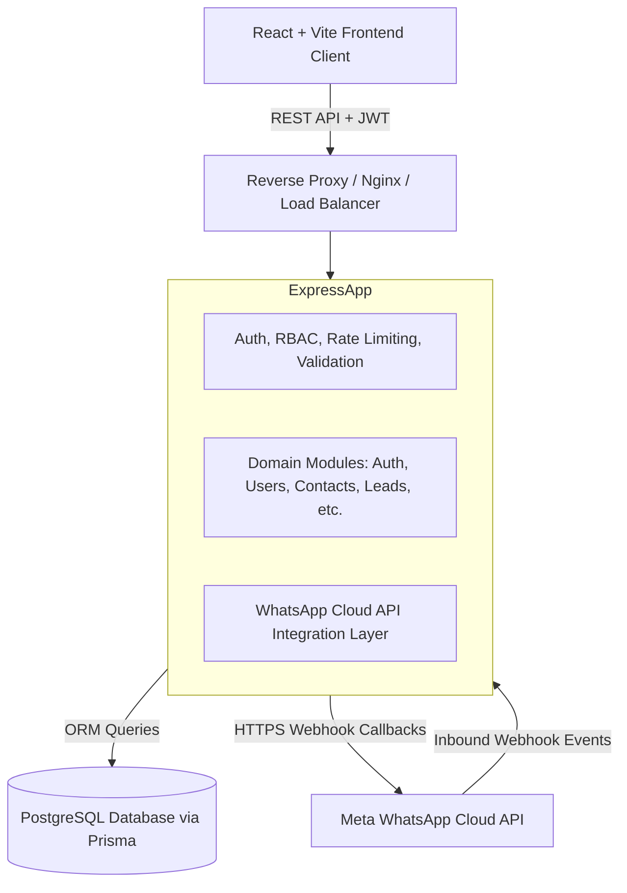

# WhatsApp Business CRM - System Architecture

## 1. High-Level Architecture Overview

WhatsApp Business CRM is a multi-tier, modular monolith designed for high availability, compliance, and multi-agent customer communication over WhatsApp.

## 2. Backend Layering & Separation of Concerns

The backend enforces a strict **Controller-Service-Repository** architectural pattern:

1. **Controller Layer (`*.controller.js`)**:
   - Accepts HTTP requests.
   - Extracts route parameters, query strings, and body.
   - Delegates business workflows to the service layer.
   - Returns structured `ApiResponse` with HTTP status codes.
   - Contains zero database operations.

2. **Service Layer (`*.service.js`)**:
   - Encapsulates domain logic, workflow orchestration, and business rules.
   - Evaluates permissions, state transitions (e.g. lead stages, conversation statuses).
   - Interacts with one or more repositories.
   - Enforces business invariants and throws operational `ApiError` instances.

3. **Repository Layer (`*.repository.js`)**:
   - Exclusively interacts with Prisma Client.
   - Encapsulates raw database queries, joins, pagination calculations, transactions, and soft deletion filters.

4. **Validation Layer (`*.validation.js`)**:
   - Schema validation powered by Zod.
   - Requests are strictly parsed before hitting controllers via `validate.middleware.js`.

5. **Cross-Cutting Concerns (`src/middleware/`, `src/utils/`, `src/config/`)**:
   - Centralized authentication (`auth.middleware.js`)
   - Role & permission evaluation (`rbac.middleware.js`)
   - Central error handling (`errorHandler.middleware.js`)
   - Structured JSON logging and rate limiting

## 3. Frontend Architecture

The client application is built with **React**, **Vite**, and **Tailwind CSS**:
- **API Client Layer (`src/api/client.js`)**: Centralized Axios instance with authorization header injection and 401 interceptors.
- **Context Layer (`src/context/`)**: AuthContext managing session, JWT lifecycle, and authenticated user state.
- **Layouts (`src/layouts/`)**: `AuthLayout` for unauthenticated entry and `MainLayout` with responsive Sidebar, top navigation bar, and breadcrumbs.
- **Feature Modules (`src/features/`)**: Self-contained business components for dashboard, inbox, contacts, leads, departments, users, campaigns, reports, and settings.
- **Shared UI Library (`src/components/common/`)**: Reusable primitives (Buttons, Badges, Modals, Tables, Stat Cards).

## 4. WhatsApp Cloud API Integration Pattern

The WhatsApp integration (`server/src/integrations/whatsapp/`) maintains an asynchronous and decoupled boundary:
- **Inbound Events**: Handled via `POST /api/v1/webhooks/whatsapp`. Webhook handlers verify signatures, acknowledge receipts immediately with HTTP 200, and dispatch event payloads to processing handlers.
- **Outbound Dispatch**: Encapsulated by `whatsapp.client.js`. Outbound messages honor the 24-hour customer service window; messages sent outside this window are restricted to Meta-approved message templates.
