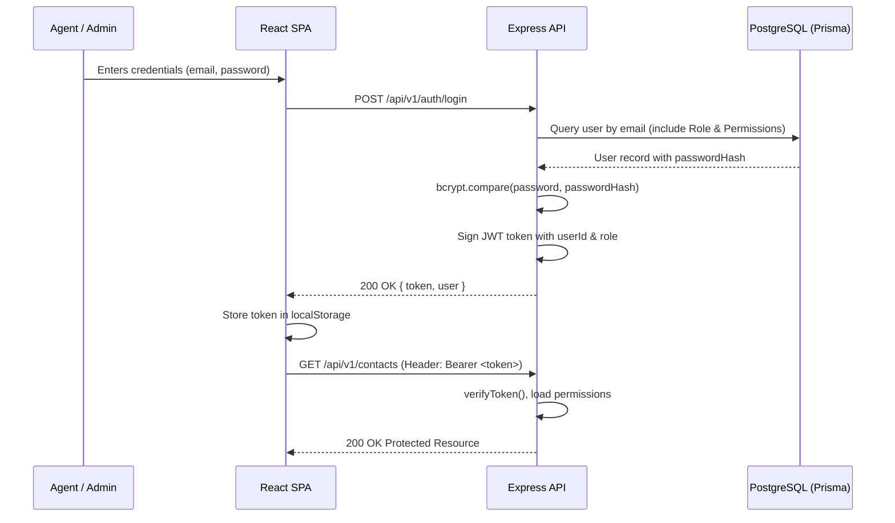

# WhatsApp Business CRM - Authentication & RBAC

## 1. Authentication Flow

Authentication uses industry-standard JSON Web Tokens (JWT) with HMAC SHA-256 signatures and bcrypt password hashing.



## 2. Token Specification

- **Header**: `Authorization: Bearer <token>`
- **Payload**:
  ```json
  {
    "userId": "uuid-v4-identifier",
    "role": "AGENT",
    "iat": 1718000000,
    "exp": 1718086400
  }
  ```
- **Expiration**: Defaults to `1d` (configurable via `JWT_EXPIRES_IN`).

## 3. Role-Based Access Control (RBAC)

The system supports a hierarchical and granular RBAC model:

### System Roles
1. **`SUPER_ADMIN`**: Full tenant-wide authority; bypasses individual permission checks.
2. **`ADMIN`**: Operational control over users, departments, settings, templates, and audits.
3. **`MANAGER`**: Departmental supervision, reporting dashboards, and marketing campaign approvals.
4. **`AGENT`**: Daily customer communication, inbox management, contact updating, and lead tracking.

### Granular Permission Slugs
Permissions follow `<module>:<action>` notation:
- `users:read`, `users:create`, `users:update`, `users:delete`
- `departments:read`, `departments:create`, `departments:update`, `departments:delete`
- `contacts:read`, `contacts:create`, `contacts:update`, `contacts:delete`
- `leads:read`, `leads:create`, `leads:update`, `leads:delete`
- `conversations:read`, `conversations:reply`, `conversations:assign`, `conversations:close`
- `campaigns:read`, `campaigns:create`, `campaigns:approve`
- `reports:read`, `audit:read`

### Middleware Protection
Routes can be protected using:
```javascript
// Check specific role
router.use(requireRoles(ROLES.ADMIN, ROLES.SUPER_ADMIN));

// Check granular permission slug
router.post('/', requirePermissions(PERMISSIONS.CONTACTS_CREATE), contactController.create);
```
