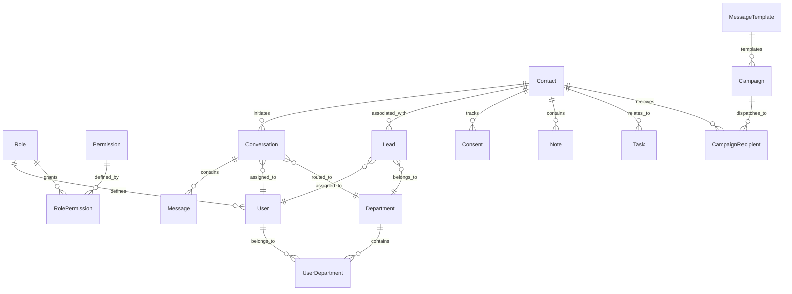

# WhatsApp Business CRM - Database Design & Data Model

## 1. Overview

The database is built on **PostgreSQL** and managed using **Prisma ORM**. The schema supports enterprise multi-agent support, flexible department routing, CRM lead management, and WhatsApp messaging protocols.

## 2. Entity-Relationship Overview

## 3. Core Entities & Schema Reference

### 3.1 Identity & RBAC
- **`User`**: Core authenticated identity. Fields: `id`, `email`, `passwordHash`, `firstName`, `lastName`, `phone`, `avatarUrl`, `status` (`ACTIVE`, `INACTIVE`, `SUSPENDED`), `roleId`, `createdAt`, `updatedAt`, `deletedAt`.
- **`Role`**: Predefined roles: `SUPER_ADMIN`, `ADMIN`, `MANAGER`, `AGENT`.
- **`Permission`**: Fine-grained authorization slugs (e.g. `contacts:read`, `conversations:reply`).
- **`RolePermission`**: Composite join table `[roleId, permissionId]`.
- **`Department`**: Organizational units for ticket and lead routing (e.g. "Customer Support", "Sales").
- **`UserDepartment`**: Many-to-many relationship tracking department assignments and `isPrimary` designation.

### 3.2 CRM Data Model
- **`Contact`**: Unified customer profile. Unique `phone` and `waId`. Tracks consent status (`GRANTED`, `REVOKED`, `PENDING`), `isOptedOut`, `optOutAt`, arbitrary custom metadata via `customFields (JSONB)`, and soft delete `deletedAt`.
- **`Lead`**: Sales pipeline entity linked to a contact. Supports pipeline stages (`NEW`, `CONTACTED`, `QUALIFIED`, `PROPOSAL_SENT`, `NEGOTIATION`, `WON`, `LOST`), estimated financial value, currency, and assignment.

### 3.3 Messaging & Shared Team Inbox
- **`Conversation`**: Support ticket / conversation thread linked to a contact, assigned agent, and department. Statuses: `OPEN`, `PENDING`, `RESOLVED`, `CLOSED`.
- **`Message`**: Individual chat message. Tracks `direction` (`INBOUND`, `OUTBOUND`), `type` (`TEXT`, `IMAGE`, `DOCUMENT`, `TEMPLATE`, `INTERACTIVE`), `status` (`QUEUED`, `SENT`, `DELIVERED`, `READ`, `FAILED`), and Meta's unique message ID `waMessageId`.

### 3.4 Marketing & Compliance
- **`MessageTemplate`**: Approved WhatsApp templates with variables, categories (`MARKETING`, `UTILITY`, `AUTHENTICATION`), and language codes.
- **`Campaign`**: Outbound broadcasts. Lifecycle stages: `DRAFT`, `PENDING_APPROVAL`, `APPROVED`, `SCHEDULED`, `RUNNING`, `PAUSED`, `COMPLETED`, `CANCELLED`.
- **`CampaignRecipient`**: Dispatched recipient records tracking delivery metrics.
- **`Consent`**: Audit trail for opt-ins, capturing source, timestamp, IP address, and proof of consent.

### 3.5 Operational Trail
- **`AuditLog`**: Immutable activity trail recording `actorId`, `action`, `entity`, `entityId`, `previousState (JSONB)`, `newState (JSONB)`, `ipAddress`, `userAgent`, and `createdAt`.
- **`Notification`**: In-app agent notifications for assignments and system alerts.

## 4. Soft Delete Pattern

Entities such as `User`, `Department`, `Contact`, `Lead`, `Conversation`, `Campaign`, and `MessageTemplate` include a nullable `deletedAt` timestamp. Standard queries filter by `deletedAt: null`, preserving historical message threads and audit integrity.
