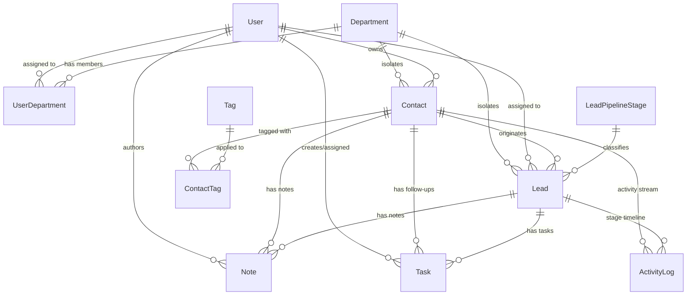

# Phase 2 — Core CRM Database Design

## Overview
Phase 2 expanded the PostgreSQL database through Prisma to implement the CRM Core entities while strictly preserving Phase 1 security models, RBAC permissions, and department boundaries.

---

## Entity-Relationship Architecture

---

## Models & Fields Added in Phase 2

### 1. `Tag` & `ContactTag`
- **Purpose**: Normalized, reusable contact classification without comma-separated string pollution.
- **Model**: `Tag` (`id`, `name` [unique], `color`, `description`, `createdAt`, `updatedAt`).
- **Join Table**: `ContactTag` (`contactId`, `tagId`, `createdAt`), with composite primary key `@@id([contactId, tagId])`.

### 2. `LeadPipelineStage`
- **Purpose**: Configurable sales pipeline stages rather than hardcoded enums.
- **Model**: `LeadPipelineStage` (`id`, `name` [unique], `order`, `color`, `isDefault`, `createdAt`, `updatedAt`).
- **Seeded Defaults**: `NEW` (0), `CONTACTED` (1), `QUALIFIED` (2), `WON` (3), `LOST` (4).

### 3. `ActivityLog`
- **Purpose**: Full lifecycle tracking of customer events (contact created, owner updated, lead stage changed, task created/completed, note added).
- **Model**: `ActivityLog` (`id`, `actorId`, `action`, `entityType`, `entityId`, `contactId`, `leadId`, `description`, `metadata`, `createdAt`).
- **Indexes**: Indexed on `contactId`, `leadId`, `actorId`, `[entityType, entityId]`, `createdAt`.

### 4. Extended Existing Models
- **`Department`**: Added `managerId` referencing `User` (`DepartmentManager`).
- **`Contact`**:
  - Added `company`, `source` (default `DIRECT`).
  - Added `ownerId` referencing `User` (`AssignedContactOwner`).
  - Added `departmentId` referencing `Department` for record isolation.
  - Added relation `contactTags` (`ContactTag[]`), `notes`, `tasks`, and `activityLogs`.
- **`Lead`**:
  - Added `pipelineStageId` referencing `LeadPipelineStage`.
  - Added `description`, `outcome`.
  - Added relations `notes`, `tasks`, `activityLogs`.
- **`Task`**:
  - Extended status enum to include `TODO`, `PENDING`, `IN_PROGRESS`, `COMPLETED`, `CANCELLED`.
  - Priorities: `LOW`, `MEDIUM`, `HIGH`, `URGENT`.
  - Added `completedAt` timestamp tracking.

---

## Data Integrity & Safe Migrations
- Foreign keys utilize `ON DELETE CASCADE` for child join tables (`contact_tags`, `user_departments`) while preventing cascading deletes on organizational units (`Department`, `User`).
- All duplicate identification checks compare normalized E.164 phone numbers.
- Deletion operations use soft-deletion (`deletedAt IS NULL`) to preserve audit and activity integrity.
