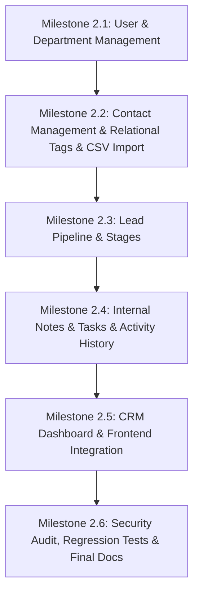

# Phase 2 Implementation Plan — Core CRM System
**Project**: WhatsApp Business CRM  
**Organization**: Stech Solutions  
**Repository Branch**: `feature/phase-2-crm-core`  
**Milestone**: Phase 2 — Core CRM Implementation  

---

## 1. Executive Summary & Repository Audit

### 1.1 Existing Baseline Inventory (Phase 1 Accomplishments)
- **Architecture**: Modular monolith with Layered Architecture (Controller -> Service -> Repository -> Prisma ORM -> PostgreSQL).
- **Identity & RBAC**: JWT Authentication (`/api/v1/auth/login`, `/register`, `/me`), bcrypt password hashing, 4 System Roles (`SUPER_ADMIN`, `ADMIN`, `MANAGER`, `AGENT`), 25 granular permission slugs, permission guard middleware (`requirePermissions`, `requireRoles`).
- **Department Routing**: User-department junction (`UserDepartment`), departmental conversation routing, and record access isolation.
- **WhatsApp Integration Layer**: Webhook verification and inbound acknowledgment (`/api/v1/webhooks/whatsapp`), client abstraction with 24-hour service window logic.
- **Frontend SPA**: React 18 + Vite + Tailwind CSS with responsive Sidebar, Header, `AuthContext`, and 10 route views.
- **Testing**: 15 backend tests in 4 suites (`auth.test.js`, `health.test.js`, `phase1-security-verification.test.js`, `whatsapp.webhook.test.js`) all passing with 100% success.

---

### 1.2 Identified Gaps for Phase 2

| Module / Scope | Current Phase 1 Status | Phase 2 Implementation Requirement |
| :--- | :--- | :--- |
| **User Management** | Basic user CRUD; no status toggle, no SUPER_ADMIN self-deletion guard, no department manager role scoping | Full staff admin APIs (`/status`, `/departments`), role elevation checks, session invalidation, full React modal UI |
| **Department Management** | Basic CRUD; no user assignment endpoints, no manager designation, no member counts | `/departments/:id/users` assignment & removal, `managerId` relation, member and active chat metrics |
| **Contact Management** | Basic phone/email CRUD, simple tags array, no CSV import, no normalized E.164 duplicate identification | `company`, `source`, `ownerId`, `departmentId`, relational tags, CSV import engine with validation and marketing consent safeguards |
| **Lead Management** | Basic CRUD with static enum stages | Relational `LeadPipelineStage` model, outcome tracking, activity emission, interactive Kanban pipeline |
| **Contact Tags** | Simple string array on Contact | Relational `Tag` & `ContactTag` models, CRUD, duplicate prevention, relational filter APIs |
| **Internal Notes** | Placeholder module | Full relational notes on Contacts & Leads with author tracking, internal-only flag, parent access authorization |
| **Follow-up Tasks** | Placeholder module | Full Task CRUD linked to Contacts & Leads, priorities (`LOW`, `MEDIUM`, `HIGH`, `URGENT`), statuses (`TODO`, `IN_PROGRESS`, `COMPLETED`, `CANCELLED`), due dates |
| **Activity History** | Not implemented | `ActivityLog` model & service recording contact/lead/task/note lifecycle events, accessible only to authorized staff |
| **CRM Dashboard** | Mock stats in frontend | Real PostgreSQL aggregated metrics (accessible contacts, leads by stage, tasks due soon, overdue tasks, assigned-to-me leads) with department isolation |
| **Testing** | 15 Phase 1 tests | Comprehensive Phase 2 test suite for RBAC, department isolation, CSV import, duplicate detection, tasks, notes, and dashboard calculations |

---

## 2. Database Schema Refinements & Migrations

To support Phase 2 without breaking existing Phase 1 entities or data:

1. **Tag & ContactTag**:
   - `Tag`: `id`, `name` (unique), `color`, `description`, timestamps.
   - `ContactTag`: composite key `[contactId, tagId]`, cascade delete.
2. **LeadPipelineStage**:
   - `id`, `name` (unique), `order`, `color`, `isDefault`, timestamps.
   - Seed default stages: `NEW`, `CONTACTED`, `QUALIFIED`, `WON`, `LOST`.
   - Update `Lead` to reference `pipelineStageId` (retaining `stage` enum for backward compatibility).
   - Add `description` and `outcome` to `Lead`.
3. **Contact Enhancements**:
   - Add `company`, `source`, `ownerId` (references `User`), `departmentId` (references `Department`).
4. **Department Enhancements**:
   - Add `managerId` (references `User`).
5. **ActivityLog**:
   - `id`, `actorId`, `action`, `entityType`, `entityId`, `contactId`, `leadId`, `description`, `metadata` (JSON), `createdAt`.
6. **Task Enhancements**:
   - Add `TODO` to `TaskStatus` enum or alias.

---

## 3. Dependency Order & Milestone Sequence

### Milestone Breakdown

### Milestone 2.1 — User & Department Management
- Extend `users.routes.js`, `users.service.js`, `users.repository.js`:
  - `PATCH /api/v1/users/:id/status`
  - `PUT /api/v1/users/:id/departments`
  - Role hierarchy validation: non-SUPER_ADMIN cannot create or elevate users to SUPER_ADMIN.
  - Guard against deactivating or deleting the last active SUPER_ADMIN.
- Extend `department.routes.js`, `department.service.js`:
  - `GET /api/v1/departments/:id/users`
  - `POST /api/v1/departments/:id/users`
  - `DELETE /api/v1/departments/:id/users/:userId`
- Frontend: Users Management modal forms (create, edit, toggle status) and Departments Management view.

### Milestone 2.2 — Contact Management, Relational Tags & CSV Import
- Database migration for `Tag`, `ContactTag`, and Contact relations (`ownerId`, `departmentId`, `company`, `source`).
- Seed initial tags.
- Tag routes & controller: `GET`, `POST`, `PATCH`, `DELETE /api/v1/tags`.
- Contact deduplication utility (normalized E.164 phone check).
- CSV import engine: `POST /api/v1/contacts/import` with preview, column mapping, row-by-row validation, duplicate reporting, and strict marketing consent non-opt-in rule.
- Department isolation on Contact listing, search, creation, and retrieval.
- Frontend: Contacts table with search/filters, contact creation modal, detail view, and CSV import modal.

### Milestone 2.3 — Lead Pipeline & Stages
- Database migration for `LeadPipelineStage` and Lead extensions.
- Seed default pipeline stages: `NEW`, `CONTACTED`, `QUALIFIED`, `WON`, `LOST`.
- Pipeline stages API: `GET`, `POST`, `PATCH /api/v1/leads/stages`.
- Lead CRUD with ownership, contact association, outcome tracking, and department filtering.
- Frontend: Interactive Leads Kanban pipeline board and list view.

### Milestone 2.4 — Internal Notes, Follow-up Tasks & Activity History
- Implement Notes module: `POST`, `GET`, `DELETE /api/v1/notes` linked to contact/lead with parent access verification.
- Implement Tasks module: `GET`, `POST`, `PATCH`, `DELETE /api/v1/tasks` with status transitions, overdue computation, priorities, and assigned-to-me filters.
- Implement `ActivityLog` service: centralized event recording on contact, lead, task, and note modifications.
- Activity history endpoint: `GET /api/v1/contacts/:id/activity` and `GET /api/v1/leads/:id/activity`.
- Frontend: Tasks page with overdue indicators, and Activity Timeline on contact/lead drawers.

### Milestone 2.5 — CRM Dashboard & Full Frontend Integration
- Dashboard API: `GET /api/v1/dashboard/metrics` with real database queries honoring user's department isolation.
- Update `DashboardPage.jsx` to fetch real database metrics, with empty states and error recovery.
- Add `/tasks` route and update navigation bar.

### Milestone 2.6 — Security Verification, Regression Tests & Final Documentation
- Run full Phase 1 regression test suite (15 tests).
- Add comprehensive Phase 2 test suite:
  - User privilege escalation checks.
  - Department isolation verification for contacts, leads, notes, and dashboard.
  - CSV import validation & duplicate detection tests.
  - Task status and overdue computation tests.
- Verify frontend production build (`npm run build`).
- Complete documentation deliverables (`docs/phase-2-*.md`).
