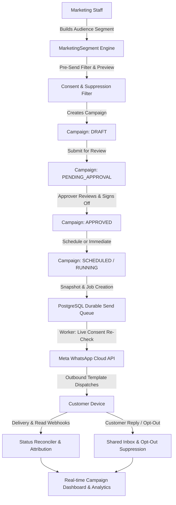

# Phase 5 Implementation Plan — Marketing Campaigns, Audience Segmentation, Scheduling & Automation

## 1. Executive Summary & Baseline Audit
- **Repository**: `https://github.com/irs682/whatsapp-business-crm`
- **Current Branch**: `feature/phase-5-marketing-automation` (derived from `feature/phase-4-whatsapp-cloud-api`)
- **Baseline Verification**:
  - 44/44 unit and integration tests passing across 7 test suites.
  - Phase 1 (Foundation/Auth), Phase 2 (CRM Core), Phase 3 (Shared Inbox), Phase 4 (Meta Cloud API Integration) fully intact.
  - No remote git push permitted without user authorization.
  - Working tree clean.

## 2. Phase 5 Objectives & Architecture
The objective of Phase 5 is to deliver a complete, enterprise-grade WhatsApp Marketing & Campaign Automation engine, modeled after platforms such as Wati and Interakt, built natively on our existing PostgreSQL, Express, React, and Meta Cloud API infrastructure.

## 3. Database Schema Design (Additions & Enhancements)
1. **MarketingSegment & Filter Entities**:
   - `MarketingSegment`: ID, name, description, departmentId, createdById, filters (JSON: tags, leadStages, sources, consentStatus, isOptedOut, departments, date ranges), isArchived.
2. **Consent History & Suppression**:
   - `Consent`: Extended with `actorId`, `proof`, `notes`, `ipAddress`, tracking opt-in / opt-out timestamps and audit trail.
3. **Campaign Enhancements**:
   - `Campaign`: Enhanced with `type`, `audienceSegmentId`, `parameters` (template variable mappings), `timezone`, `scheduledAt`, `startedAt`, `completedAt`, `pausedAt`, `cancelledAt`, `rejectionReason`, `approvalComment`, and full delivery/response counters (`totalRecipients`, `eligibleCount`, `suppressedCount`, `sentCount`, `deliveredCount`, `readCount`, `failedCount`, `repliedCount`, `optOutCount`).
   - `CampaignApproval`: ID, campaignId, approverId, action (`APPROVED`, `REJECTED`), comment, createdAt.
   - `CampaignRecipient`: Enhanced with unique composite key `[campaignId, contactId]`, status (`QUEUED`, `PROCESSING`, `SENT`, `DELIVERED`, `READ`, `FAILED`, `SUPPRESSED`, `SKIPPED`), `errorMessage`, `sentAt`, `deliveredAt`, `readAt`.
   - `CampaignSendJob`: Durable message queue job for background dispatch, tracking `status` (`PENDING`, `CLAIMED`, `COMPLETED`, `FAILED`), retry attempts, exponential backoff, locking timestamps.
   - `CampaignActivityLog`: Immutable audit trail of lifecycle transitions.
4. **Marketing Automation Rules**:
   - `MarketingAutomationRule`: Triggers, conditions, actions (`CREATE_TASK`, `SEND_TEMPLATE`, `ASSIGN_DEPARTMENT`, `SUPPRESS_CONTACT`).
   - `AutomationExecution`: Log of rule executions, status, and payload.

## 4. RBAC & Security Enhancements
Add granular permissions without breaking existing roles:
- `campaigns:read`, `campaigns:create`, `campaigns:update`, `campaigns:approve`, `campaigns:schedule`, `campaigns:start`, `campaigns:cancel`
- `segments:read`, `segments:manage`
- `marketing_consent:read`, `marketing_consent:manage`
- `automations:read`, `automations:manage`
Enforce maker-checker policy: campaign creators cannot approve their own campaigns without explicit administrative override.

## 5. Durable Queue & Worker Architecture
- Database-backed durable queue using PostgreSQL atomic update state transitions (`PENDING` -> `CLAIMED`).
- Worker respects rate limits (configurable messages per second, default 20 msg/sec to stay safely under Meta tier limits).
- Re-checks contact consent and `isOptedOut` immediately before calling Meta Cloud API. If contact opted out while campaign was running or scheduled, message is marked `SUPPRESSED` and omitted.
- Pause and Cancel actions take immediate effect on unsubmitted jobs.

## 6. Milestones Execution Schedule
- **Milestone 5.1**: Audit, Baseline Verification, Schema Migration, RBAC Permissions, Implementation Plan.
- **Milestone 5.2**: Audience Segmentation & Marketing Consent Management.
- **Milestone 5.3**: WhatsApp Campaign Management Engine & Creation Wizard.
- **Milestone 5.4**: Campaign Approval Workflow (Maker-Checker) & UTC Timezone Scheduling.
- **Milestone 5.5**: Durable Queue Architecture & Resilient Worker Dispatcher.
- **Milestone 5.6**: Operational Execution Controls (Start, Pause, Resume, Cancel) & Pre-Send Validation.
- **Milestone 5.7**: Customer Response Attribution, Inbound Webhook Opt-Out, & Real-time Analytics Dashboard.
- **Milestone 5.8**: Marketing Automation Rules Engine.
- **Milestone 5.9**: Automated Testing, Frontend Production Build, Complete Documentation, & Final Phase 5 Report.
