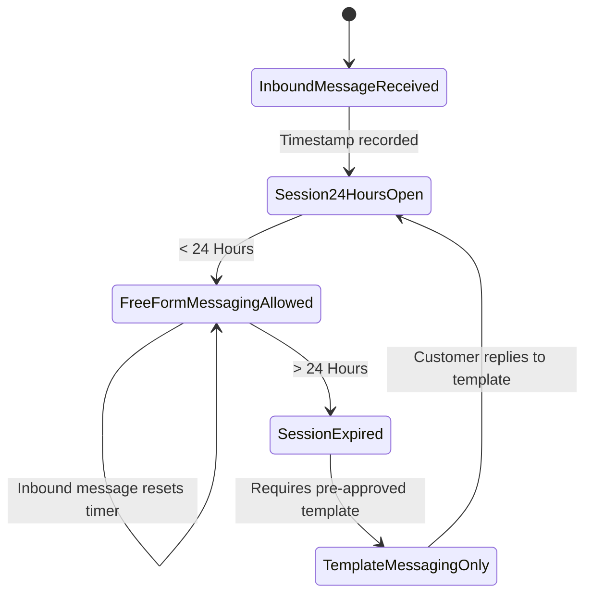

# WhatsApp Business Platform Integration Architecture

This document describes the design, policies, and workflows for integrating with Meta's **WhatsApp Business Cloud API**.

## 1. Meta 24-Hour Customer Care Window Policy

Meta enforces strict rules on outbound business messaging:
- **Inside 24-Hour Window**: When a customer sends an inbound message to the business phone number, a 24-hour customer care session opens. Agents can send free-form text, attachments, and audio messages without pre-approval.
- **Outside 24-Hour Window**: Once 24 hours elapse since the customer's last message, free-form replies are blocked by Meta. The business can only initiate contact using **pre-approved WhatsApp Message Templates**.

## 2. Inbound Message Processing Pipeline

1. **Meta Webhook POST**: Meta posts event to `/api/v1/webhooks/whatsapp`.
2. **Immediate Acknowledgment**: Endpoint returns HTTP 200 within 3 seconds to avoid webhook retries and throttling.
3. **Event Ingestion**:
   - Extract `wa_id`, customer profile name, and message payload (`text`, `image`, `button_reply`, etc.).
   - Query or create `Contact` by `phone` / `waId`.
   - Locate active `Conversation` or open a new one with `status: OPEN`.
   - Persist `Message` record with `direction: INBOUND`, `status: DELIVERED`.
   - Update `Conversation.lastMessageAt` and increment `unreadCount`.
   - Evaluate opt-out keywords (`STOP`, `UNSUBSCRIBE`). If detected, mark `Contact.isOptedOut = true` and `consentStatus = REVOKED`.

## 3. Outbound Message Pipeline

1. Agent creates reply via Shared Inbox UI or bulk campaign triggers.
2. Service evaluates whether `Conversation` is within the 24h window.
3. If outside the window, validate that a valid `templateId` is supplied.
4. `WhatsAppClient` dispatches payload to Meta Graph API (`/v21.0/{PHONE_NUMBER_ID}/messages`).
5. Store returned `wamid` on the `Message` record with `status: SENT`.
6. Subsequent delivery and read receipts update the status to `DELIVERED` and `READ`.
